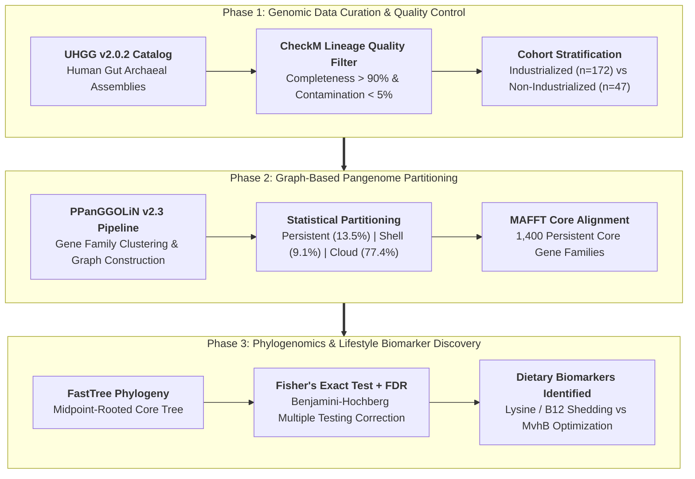
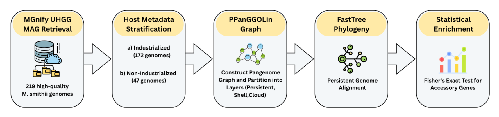
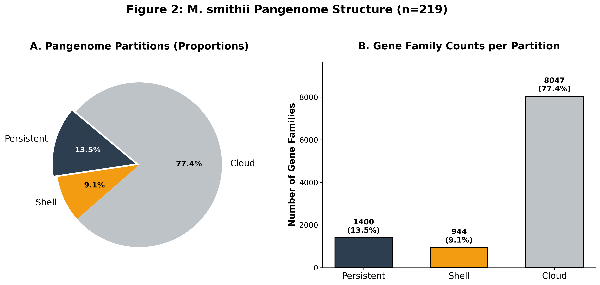
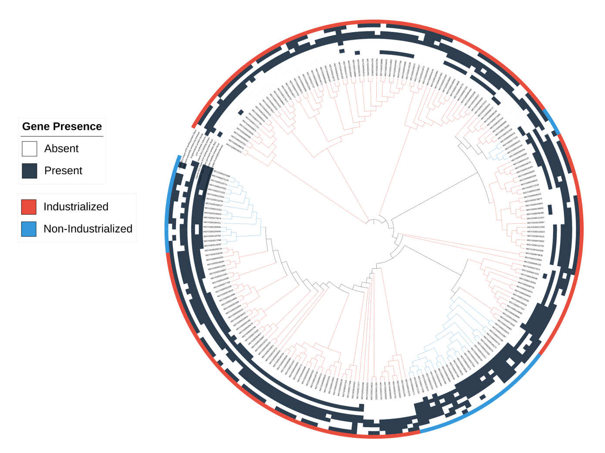
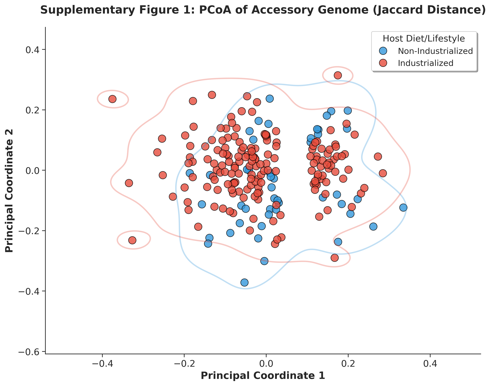
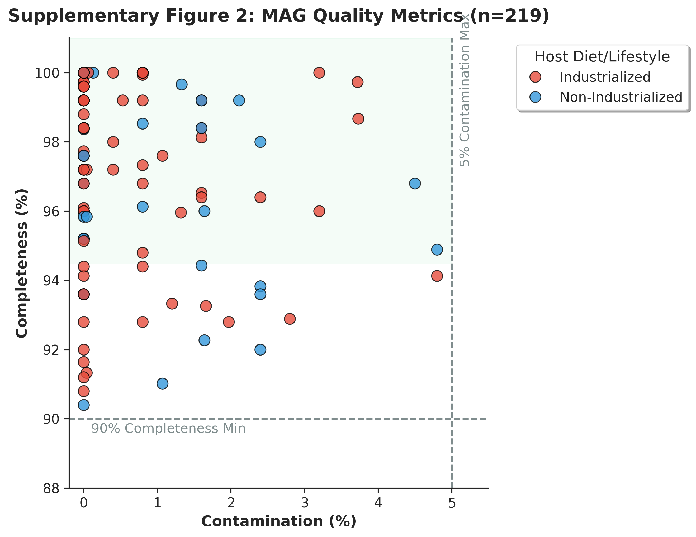

# Host Industrialization Drives Dietary-Dependent Structural Variation and Gene Shedding in the Human Gut Archaeon *Methanobrevibacter smithii*

**Author(s):** Md Abu Sadat Soash  
*Department of Genetic Engineering and Biotechnology*<br>
*Shahjalal University of Science and Technology, Sylhet, Bangladesh*

[](https://colab.research.google.com/drive/1-ZKFKmX9j_sWk19xfGzZq70B_CoDLOGp?usp=drive_link)
[](https://github.com/Soash/m-smithii-lifestyle-pangenome)
[](https://www.ebi.ac.uk/metagenomics/)
[](https://github.com/labgem/PPanGGOLiN)
[](https://ecogenomics.github.io/CheckM/)

---

## Abstract

* **Objective:** *Methanobrevibacter smithii* is the primary archaeal keystone species in the human gut, responsible for syntrophic hydrogen removal to sustain digestive thermodynamic efficiency. While bacterial adaptation to Western diets and host industrialization has been heavily investigated, the structural plasticity and evolutionary dynamics of the gut archaeome remain critically uncharacterized due to an over-reliance on 16S rRNA amplicon sequencing.
* **Methodology:** We conducted a pan-metagenomic dissection of 219 high-quality *M. smithii* Metagenome-Assembled Genomes (MAGs; $>90\%$ completeness, $<5\%$ contamination) retrieved from the MGnify Unified Human Gastrointestinal Genome (UHGG v2.0.2) catalog. Genomes were stratified into an **Industrialized cohort** (United States and United Kingdom; $n=172$) and a **Non-Industrialized cohort** (Peru, Fiji, Madagascar; $n=47$). Pangenome partitioning was performed using **PPanGGOLiN**, followed by core-gene phylogenomic inference with **FastTree** and lifestyle biomarker discovery using Fisher's exact test with False Discovery Rate (FDR) correction.
* **Findings:** *M. smithii* harbors a highly open, recombinogenic pangenome composed of 10,391 gene families, dominated by a massive **cloud genome (77.4%, 8,047 families)** and a conserved persistent core of only 13.5% (1,400 families). Statistical enrichment identified pronounced, diet-driven evolutionary gene shedding in industrialized strains, characterized by the total loss of Lysine biosynthesis machinery (0.00% vs. 36.17%, $q = 9.23 \times 10^{-10}$) and extensive depletion of Vitamin B12 scavenging complexes (`btuC`/`btuD`, $q < 10^{-4}$). Conversely, industrialized strains exhibited significant structural enrichment in core methanogenesis optimization factors, specifically the electron-bifurcating **polyferredoxin protein MvhB** (81.40% vs. 44.68%, $q = 2.83 \times 10^{-4}$) and ATP synthase subunit c (93.02% vs. 61.70%, $q = 1.26 \times 10^{-4}$).
* **Implications:** *M. smithii* is not a static commensal but a genetically fluid symbiote whose accessory genome is actively sculpted by host dietary history. Western diets high in animal protein and bioavailable micronutrients render endogenous synthesis pathways dispensable, driving genome streamlining while selecting for enhanced methanogenic efficiency.

---

## 1. Introduction & Biological Background

The human gut microbiome is an essential metabolic partner governing nutrient harvest, immune education, and epithelial integrity. While the bacterial domain has been thoroughly profiled across diverse populations, the archaeome—frequently described as the "dark matter" of the human gut—remains understudied. *Methanobrevibacter smithii* dominates the gut archaeal community, consuming hydrogen gas ($\text{H}_2$) and formate produced during primary saccharolytic bacterial fermentation to produce methane ($\text{CH}_4$). This syntrophic gas scavenging prevents inhibitory hydrogen buildup, maintaining favorable bioenergetics for the entire microbial consortium.

```
                   Host Industrialization Gradient
                                 │
                 ┌───────────────┴───────────────┐
                 ▼                               ▼
       Westernized Industrial Diet       Traditional Non-Industrial Diet
      (High Animal Protein / Fat,       (Agrarian / Complex Plant Fibers,
        Abundant Micronutrients)            Scarce Micronutrients)
                 │                               │
                 ▼                               ▼
      Evolutionary Gene Shedding:       Metabolic Retention:
      • Loss of Lysine synthesis        • Intact Lysine biosynthesis
      • Depletion of B12 pumps          • Active BtuC/BtuD scavenging
      • Loss of RcsC environmental      • Robust environmental sensing
        histidine kinases                 machinery
                 │                               │
                 └───────────────┬───────────────┘
                                 ▼
         Accelerated Methanogenic Optimization (MvhB & ATP Synthase)
```

1. **Lifestyle-Driven Micro-Evolution:** Industrialization—marked by sterile sanitation, widespread antibiotic exposure, and ultra-processed food intake—has reshaped human gut ecosystems. However, previous studies utilized short-read 16S rRNA sequencing that obscures sub-species structural variation and gene presence/absence dynamics.
2. **The Accessory Genome as an Evolutionary Ledger:** Microbial adaptation to localized environmental shifts occurs primarily through gene gain, loss, and horizontal transfer within the accessory pangenome.
3. **Study Aims:** Using 219 non-redundant, high-quality MAGs, this investigation identifies the structural genomic hallmarks and metabolic trade-offs that distinguish industrialized from traditional *M. smithii* populations.

---

## 2. Genomic Dataset & Cohort Stratification

Genomes were extracted from the MGnify Unified Human Gastrointestinal Genome (UHGG v2.0.2) repository, applying strict CheckM lineage-specific thresholds (>90% completeness, <5% contamination) to eliminate assembly fragmentation artifacts:

| Cohort Classification | Sample Size ($n$) | Geographic Origin | Dietary Baseline & Ecological Characteristics |
| :--- | :---: | :--- | :--- |
| **Industrialized Cohort** | **172** | United States ($n=126$), United Kingdom ($n=46$) | Westernized diet: high animal protein, refined sugars, saturated fats, low complex fiber |
| **Non-Industrialized Cohort** | **47** | Peru ($n=21$), Fiji ($n=16$), Madagascar ($n=10$) | Traditional agrarian diet: rich in unrefined tubers, resistant starches, low animal products |
| **Total Curated Dataset** | **219** | Global High-Quality MAGs | Strict CheckM thresholds ($>90\%$ completeness, $<5\%$ contamination) |

Genomes from transitional economies, regions with distinct Mediterranean or Nordic dietary patterns, and those with ambiguous metadata were excluded to prevent cohort admixture from attenuating statistical signals.

---

## 3. Computational Pipeline Architecture



---

## 4. Key Scientific Findings & Comparative Analysis

### 4.1 Pangenomic Partitioning & Open Repertoire

PPanGGOLiN analysis across the 219 MAGs resolved a total of **10,391 homologous gene families**. The persistent genome—comprising genes shared across $\ge 95\%$ of strains—represented only a small fraction of total genetic diversity, highlighting intense environmental selection:

| Pangenome Partition | Gene Family Count | Proportion (%) | Biological Role & Evolutionary Dynamics |
| :--- | :---: | :---: | :--- |
| **Persistent Genome ($\ge 95\%$)** | **1,400** | **13.47%** | Conserved archaeal core: replication, transcription, basal methanogenesis |
| **Shell Genome ($15\% - 95\%$)** | **944** | **9.08%** | Intermediate conservation: clade-specific metabolic adaptations |
| **Cloud Genome ($< 15\%$)** | **8,047** | **77.44%** | Strain-specific accessory pool: horizontal transfers, prophages, niche genes |
| **Total Pan-Genome** | **10,391** | **100.0%** | Highly open, dynamic pangenomic architecture |

### 4.2 Lifestyle-Associated Accessory Gene Biomarkers

Statistical enrichment using Fisher's exact test with Benjamini-Hochberg FDR correction identified key metabolic modules undergoing selective loss or gain:

| Gene Family ID | Functional Annotation | Industrialized (%)<br>($n=172$) | Non-Industrialized (%)<br>($n=47$) | Raw *p*-value | FDR *q*-value | Functional Consequence |
| :--- | :--- | :---: | :---: | :---: | :---: | :--- |
| `MGYG000211034_00116` | 2,3,4,5-tetrahydropyridine-2,6-dicarboxylate N-acetyltransferase | **0.00%** | **36.17%** | $3.01 \times 10^{-13}$ | **$9.23 \times 10^{-10}$** | Total loss of Lysine synthesis in Western diets |
| `MGYG000259779_00903` | Sensor histidine kinase RcsC | 22.67% | 70.21% | $3.16 \times 10^{-9}$ | **$3.23 \times 10^{-6}$** | Depletion of environmental sensing machinery |
| `MGYG000211034_01500` | Cobalamin import system permease BtuC | 50.00% | 91.49% | $7.88 \times 10^{-8}$ | **$5.36 \times 10^{-5}$** | Loss of high-affinity Vitamin B12 permease |
| `MGYG000259779_01487` | Vitamin B12 import ATP-binding protein BtuD | 8.72% | 42.55% | $3.42 \times 10^{-7}$ | **$1.75 \times 10^{-4}$** | Loss of active Vitamin B12 import ATPase |
| `MGYG000155887_00579` | Extracellular Vitamin B12-binding protein | 50.00% | 89.36% | $5.90 \times 10^{-7}$ | **$2.41 \times 10^{-4}$** | Depletion of extracellular cobalamin capture |
| `MGYG000259779_01153` | ATP synthase subunit c | **93.02%** | 61.70% | $6.33 \times 10^{-7}$ | **$2.41 \times 10^{-4}$** | Enrichment in proton/sodium coupling and ATP generation |
| `MGYG000171336_01359` | Polyferredoxin protein MvhB | **81.40%** | 44.68% | $1.63 \times 10^{-6}$ | **$2.83 \times 10^{-4}$** | Electron bifurcation optimization in methanogenesis |
| `MGYG000190668_00503` | Beta-barrel assembly-enhancing protease | 12.21% | 42.55% | $1.15 \times 10^{-5}$ | **$1.76 \times 10^{-3}$** | Depletion of membrane assembly machinery |

### 4.3 Mechanistic Rationale: Dietary Scavenging vs. Gene Shedding

```
                     ┌────────────────────────────────────────┐
                     │          Western Gene Shedding         │
                     │          ─────────────────────         │
                     │  • Abundant dietary B12 and Lysine     │
                     │  • Energetic cost of synthesis > yield │
                     │  • Natural deletion of btuC/D & DAP    │
                     └────────────────────────────────────────┘

                     ┌────────────────────────────────────────┐
                     │       Methanogenesis Optimization      │
                     │       ───────────────────────────      │
                     │  • Altered bacterial fermentation H2   │
                     │  • MvhB polyferredoxin electron relay  │
                     │  • ATP synthase subunit c upregulation │
                     └────────────────────────────────────────┘
```

* **Evolutionary Gene Shedding:** Western diets provide an overabundance of bioavailable amino acids and cobalamin. In this nutrient-dense milieu, maintaining endogenous synthetic factories and high-affinity transport systems imposes an unnecessary metabolic burden, driving adaptive genome reduction. In contrast, agrarian diets create nutrient scarcity, compelling *M. smithii* to retain autonomous synthesis machinery.
* **Methanogenic Electron Bifurcation:** The significant enrichment of the polyferredoxin protein **MvhB** in industrialized strains demonstrates structural tuning of the core methanogenesis pathway. Shifts in bacterial fermentation kinetics in the Western gut force *M. smithii* to optimize electron bifurcation to maintain thermodynamic viability.

---

## 5. Visual Highlights & Comparative Figures

<p align="center">
  
</p>
<p align="center"><b>Figure 1: Pan-Metagenomic Bioinformatics Workflow.</b> Systematic protocol from UHGG retrieval and CheckM quality filtering to PPanGGOLiN graph partitioning, FastTree core phylogenomics, and statistical biomarker discovery.</p>

<p align="center">
  
  
</p>
<p align="center"><b>Figure 2 (Left): Pangenome Architecture ($n=219$).</b> Partitioning into persistent (13.5%), shell (9.1%), and massive cloud (77.4%) partitions.<br>
<b>Figure 3 (Right): Core Genome Phylogeny & Metabolic Profiles.</b> Rooted tree annotated by lifestyle (Red: Industrialized, Blue: Non-Industrialized) and presence/absence of BtuC/D and Lysine enzymes.</p>

<p align="center">
  
  
</p>
<p align="center"><b>Supplementary Figure 1 (Left): Principal Coordinates Analysis (PCoA).</b> Clustering of accessory gene presence/absence matrices.<br>
<b>Supplementary Figure 2 (Right): CheckM Assembly Evaluation.</b> Completeness vs. contamination across all 219 analyzed MAGs.</p>

---

## 6. Repository Organization

```text
m-smithii-lifestyle-pangenome/
├── data/                                                       # Curated datasets, cohorts & pangenome matrices
│   ├── hq_m_smithii.tsv                                        # Quality-filtered M. smithii MAG metadata
│   ├── industrialized_m_smithii.tsv                            # Industrialized cohort (UK/USA) MAG links
│   ├── non_industrialized_m_smithii.tsv                        # Non-industrialized cohort (Fiji/Peru/Madagascar)
│   ├── lifestyle_specific_genes.csv                            # Statistical gene association table
│   ├── FINAL_annotated_lifestyle_genes_filtered.csv            # High-confidence lifestyle genes (FDR q < 0.05)
│   ├── m_smithii_matrix/matrix.csv                             # Gene presence/absence matrix (n=221)
│   └── m_smithii_pangenome_out/partitions/                     # PPanGGOLiN core, shell & cloud gene sets
├── fig/                                                        # Publication-quality figures (PNG & vector PDF)
│   ├── Fig_1_v2.png                                            # Figure 1: Methodological pipeline
│   ├── Fig_2.png / Fig_2.pdf                                   # Figure 2: PPanGGOLiN pangenome partitions
│   └── Fig_3_v2.png                                            # Figure 3: Core phylogeny & heatmap
├── sup/                                                        # Supplementary tables, figures & iTOL trees
│   ├── Supplementary_Table_1_MAG_Metrics.csv                   # CheckM quality metrics for analyzed MAGs
│   ├── Final_annotated_lifestyle_genes_filtered.csv            # Statistical biomarker enrichment results
│   ├── m_smithii_persistent_tree.nhx                           # FastTree Newick core phylogenetic tree
│   ├── itol_color_strip.txt / itol_heatmap.txt                 # iTOL cohort & matrix tree annotations
│   ├── Supp_Fig_1_PCoA.png / Supp_Fig_1_PCoA.pdf               # Supplementary Figure 1: PCoA ordination
│   └── Supp_Fig_2_MAG_Quality.png / Supp_Fig_2_MAG_Quality.pdf # Supplementary Figure 2: CheckM quality
├── m-smithii-lifestyle-pangenome.ipynb                         # Interactive end-to-end Jupyter Notebook
├── README.md                                                   # Comprehensive project documentation
```

---

## 7. Execution, Reproducibility & Environment Setup

### 7.1 Single-Click Cloud Execution (Google Colab)
The complete workflow can be reproduced interactively in your browser with zero local setup:

[](https://colab.research.google.com/drive/1-ZKFKmX9j_sWk19xfGzZq70B_CoDLOGp?usp=drive_link)

### 7.2 Local Environment Setup
```bash
# 1. Clone repository
git clone https://github.com/Soash/m-smithii-lifestyle-pangenome.git
cd m-smithii-lifestyle-pangenome

# 2. Create conda environment
conda create -n m_smithii -c conda-forge -c bioconda ppanggolin mafft fasttree checkm-genome
conda activate m_smithii

# 3. Launch Jupyter Notebook
jupyter notebook m-smithii-lifestyle-pangenome.ipynb
```

### 7.3 External Raw Reference Dumps & Assemblies
Curated metadata subsets and the gene presence/absence matrix (`data/m_smithii_matrix/matrix.csv`) are bundled directly with the repository for instant analysis. Raw reference archives exceeding GitHub's 100 MB limit can be retrieved on demand:

```bash
# 1. Download complete MGnify human gut catalog v2.0.2 metadata dump (110 MB)
wget -P data/ https://ftp.ebi.ac.uk/pub/databases/metagenomics/mgnify_genomes/human-gut/v2.0.2/genomes-all_metadata.tsv

# 2. Download raw GFF assemblies for all 221 MAGs (476 MB)
mkdir -p data/genomes/industrialized data/genomes/non_industrialized
awk -F '\t' '{print $20}' data/industrialized_m_smithii.tsv | xargs -n 1 wget -P data/genomes/industrialized/
awk -F '\t' '{print $20}' data/non_industrialized_m_smithii.tsv | xargs -n 1 wget -P data/genomes/non_industrialized/
```

### 7.4 Interactive Phylogenomic Rendering
1. Navigate to the [Interactive Tree Of Life (iTOL)](https://itol.embl.de/).
2. Upload the tree file: [`sup/m_smithii_persistent_tree.nhx`](file:///sup/m_smithii_persistent_tree.nhx).
3. Drag and drop [`sup/itol_color_strip.txt`](file:///sup/itol_color_strip.txt) to annotate host lifestyle cohorts (Red: Industrialized, Blue: Non-Industrialized).
4. Drag and drop [`sup/itol_heatmap.txt`](file:///sup/itol_heatmap.txt) to render the metabolic presence/absence heatmap.

---

## 8. Authorship & Correspondence

If you utilize this workflow, curated datasets, or findings in your research, please cite:

> **Md Abu Sadat Soash** (2026). *Host Industrialization Drives Dietary-Dependent Structural Variation and Gene Shedding in the Human Gut Archaeon Methanobrevibacter smithii.* Department of Genetic Engineering and Biotechnology, Shahjalal University of Science and Technology, Sylhet, Bangladesh.  
> GitHub: [https://github.com/Soash/m-smithii-lifestyle-pangenome](https://github.com/Soash/m-smithii-lifestyle-pangenome)

### Inquiries
- **Md Abu Sadat Soash** — Department of Genetic Engineering and Biotechnology, Shahjalal University of Science and Technology, Sylhet, Bangladesh
- **Email:** [mdabu13@student.sust.edu](mailto:mdabu13@student.sust.edu)

---

## 9. References & Data Availability

1. **Samuel, B. S., et al. (2007).** Genomic and metabolic adaptations of *Methanobrevibacter smithii* to the human gut. *PNAS*, 104(25), 10643–10648.
2. **Sonnenburg, E. D., & Sonnenburg, J. L. (2019).** The ancestral and industrialized gut microbiota and implications for human health. *Nature Reviews Microbiology*, 17(6), 383–390.
3. **Almeida, A., et al. (2021).** A unified catalog of 204,938 reference genomes from the human gut microbiome (UHGG v2.0.2). *Nature Biotechnology*, 39(1), 105–114.
4. **Parks, D. H., et al. (2015).** CheckM: assessing the quality of microbial genomes recovered from isolates, single cells, and metagenomes. *Genome Research*, 25(7), 1043–1055.
5. **Gautreau, G., et al. (2020).** PPanGGOLiN: Depicting microbial diversity via a partitioned pangenome graph. *PLOS Computational Biology*, 16(3), e1007737.
6. **Price, M. N., Dehal, P. S., & Arkin, A. P. (2010).** FastTree 2 – Approximately Maximum-Likelihood Trees for Large Alignments. *PLoS ONE*, 5(3), e9490.
7. **Letunic, I., & Bork, P. (2024).** Interactive Tree of Life (iTOL) v6: recent updates to the phylogenetic tree display and annotation tool. *Nucleic Acids Research*, 52(W1), W78–W82.
